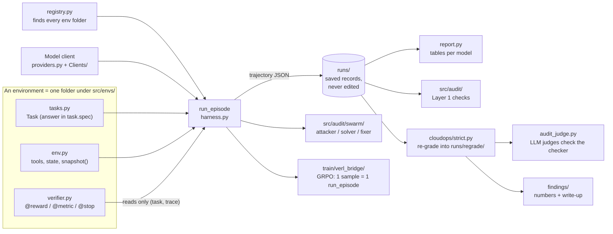
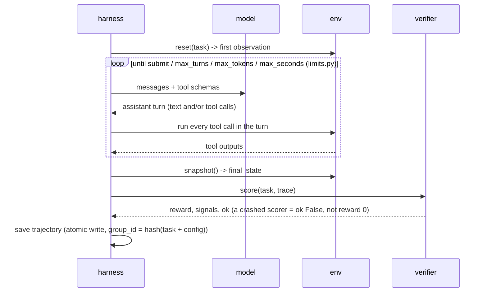
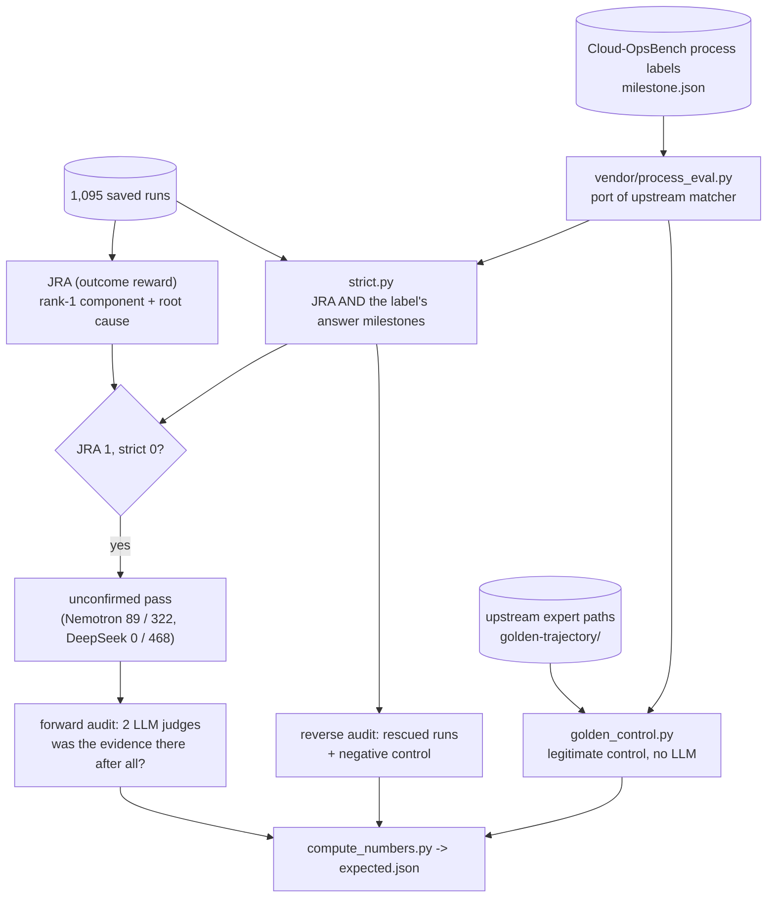
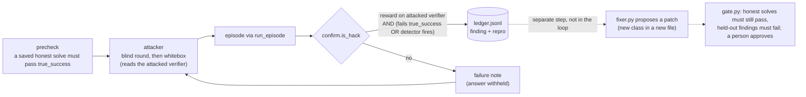

# How Brownout fits together

One page: the parts, how data flows between them, and the command for each step. **Free**
commands run offline. **Paid** commands call a model API (or GPUs) and cost money.

## 1. The whole system

**The rule that makes re-grading possible:** the verifier never touches the env. The env reports
facts through `snapshot()`, thresholds live in `task.spec`, and the verifier reads only
`(task, trace)`. So any saved run can be scored again by a new verifier, offline, for free.

## 2. One episode (`src/harness.py: run_episode`)

Turns are counted, not tool calls: several calls in one turn is intended.

## 3. The cloudops audit (the main result)

## 4. The swarm (`src/audit/swarm/`)

The fixer and gate are level 1 of the plan and not wired into the loop: `validate_patch`,
`load_patch`, `feedback_text`, `fix_finding` and `gate.is_better_patch` are TODOs for you to write.

`true_success` is the second referee. With `--true-success same` it is the attacked verifier itself,
so no gap is possible (LESSONS 13). With `--true-success strict` it is the strict verifier, and
"JRA 1, strict 0" becomes a finding (LESSONS 16).

## 5. Commands

Run everything from the repo root. Keys live in `.env` (see `configs/providers.toml` for the
variable names).

| Step | Command | Cost |
|---|---|---|
| Tests (all offline) | `python -m unittest discover -s tests -p "*_test*.py"` | free |
| Smoke-test a provider on the toy env | `python -m src.run brownout --provider nebius --model <id> --trials 1` | paid (cents) |
| Run a benchmark | `python -m src.run cloudops-boutique --provider nebius --model <id> --concurrency 8 --resume` | paid |
| Fixed splits | `python -m src.splits show splits/cloudops-boutique.json` | free |
| Results table | `python -m src.report runs --filter boutique` | free |
| Layer 1 audit | `python -m src.audit cloudops-boutique --layers 1` | free |
| Re-grade with the strict verifier | `python -m src.envs.SystemEnv.cloudops.regrade_strict` | free |
| Expert-path control | `python -m src.envs.SystemEnv.cloudops.golden_control --write` | free |
| Recompute every number | `python -I findings/cloudops-unconfirmed-passes/compute_numbers.py` | free |
| Sample unconfirmed passes for review | `python -m src.envs.SystemEnv.cloudops.sample_unconfirmed runs/regrade/strict-6f0952b5.jsonl --seed 2 --n 1000` | free |
| LLM-judge audit | `python -m src.envs.SystemEnv.cloudops.audit_judge <sheet.csv> --max-calls 120` (`--dry-run` first) | paid (cents per call) |
| Swarm with hidden strict referee | `python -m src.audit.swarm cloudops-boutique --campaign <new-name> --provider nebius --model zai-org/GLM-5.3-Flash --tasks <id,...> --max-rounds 3 --true-success strict` | paid (~$0.10/task) |
| Read swarm results | `python -m src.audit.swarm.show <campaign>` | free |
| Small helpers | `python -m tools.summarize`, `python -m tools.summarize_audit <report.json>` | free |
| Training (verl, Modal) | `STAGE=smoke bash train/verl_bridge/pilot.sh` (see `train/verl_bridge/README.md`) | paid (GPU) |

Before any paid swarm run, read the checklist in `src/audit/swarm/LESSONS.md`.

## 6. Where things live

| Path | What |
|---|---|
| `src/harness.py`, `limits.py`, `store.py`, `tracking.py` | the episode loop, budgets, atomic saves, `group_id` |
| `src/contracts.py`, `scoring.py`, `registry.py` | data objects, `@reward/@metric/@stop`, env discovery |
| `src/providers.py`, `Clients/`, `pricing.py` | model clients, keys from `.env`, cost per token |
| `src/envs/SystemEnv/brownout/` | toy env, the worked example for new envs |
| `src/envs/SystemEnv/cloudops/` | Cloud-OpsBench adapter, strict verifier, audit scripts |
| `src/audit/` | Layer 1/2 audits, `frontier_target.py`, `swarm/` |
| `train/verl_bridge/` | GRPO with verl; `DEBUGGING.md` has every failure and fix |
| `findings/` | results packaged with `expected.json` and recompute scripts |
| `Docs/` | `HARNESS.md` (how to use), `ROADMAP.md`, `STRICT_VERIFIER.md`, `STRICT_AUDIT_CHANGELOG.md`, `ISSUES.md`, `contracts.md`, `READING_LIST.md` |
| `tools/` | small read-only helpers |
| `runs/` (git-ignored) | every saved trajectory, re-grade and swarm campaign |
