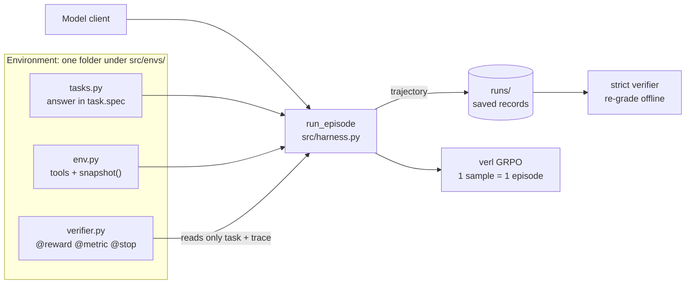

# Brownout

An open RL environment harness that checks how an agent reached its answer, not only whether it
was right. Built by one person; work in progress.

- **Website:** [brownout.pages.dev](https://brownout.pages.dev/)
- **Main finding:** [In 89 of 322 correct answers, the agent never checked the evidence](https://brownout.pages.dev/blog/unconfirmed-passes-cloud-opsbench/)
- **Repo map and every command:** [Docs/SYSTEM.md](Docs/SYSTEM.md)
- **In progress:** Harbor coding tasks trained on Miles + SGLang with FSDP2. v0.1 is planned for 30 Nov 2026.

## How it works



Every environment, eval and training sample goes through one loop, `run_episode`. The verifier
reads only the task and the saved trace and never touches the environment, so any saved run can be
graded again by a new verifier, offline and for free. A crashed scorer is recorded as `ok=False`,
never as reward 0.

```powershell
python -m unittest discover -s tests -p "*_test*.py"                                # offline tests
python -m src.run cloudops-boutique --provider nebius --model <id> --concurrency 8   # paid
python -m src.report runs --filter boutique                                         # free
python -m src.envs.SystemEnv.cloudops.regrade_strict                                # free
```

## Results on Cloud-OpsBench (Online Boutique)

**The harness matches upstream.** Labels match upstream's `process-label/` for all 550 cases, and
grading follows upstream `evaluation.py` (rank 1 only; JRA = component and fault type both right).
One difference: upstream counts tool calls against its 20-step limit, Brownout counts turns.
DeepSeek V4 Flash scores 0.859 JRA here, about 0.78 under upstream's rule (an estimate, not a
rerun). Upstream reports 0.76.

**RL on Qwen3-4B** (GRPO with verl, LoRA r64, 40 steps). One greedy run per task, compared case by
case with an exact McNemar test:

| Cases | Base | After RL | Fixed / broken | p |
|---|---|---|---|---|
| All non-code (452) | 0.235 | 0.332 | +89 / −45 | 0.0002 |
| Val + test, never trained on (138) | 0.217 | 0.362 | +30 / −10 | 0.002 |
| Train split (314) | 0.242 | 0.318 | +59 / −35 | 0.017 |

Training used 251 of the 314 train-split cases: admission, code-defect and performance cases were
left out (`modal_app.py`), so 63 train-split cases were never trained on. Gains come from runtime,
scheduling, service and startup faults; admission, performance and code-defect cases did not improve. Failures and fixes: [DEBUGGING.md](train/verl_bridge/DEBUGGING.md).

**The reward pays for answers the agent never confirmed.** JRA checks only the final answer. A
stricter verifier (`strict.py`) also requires the evidence that the benchmark's own process labels
list for the case. Re-graded over 1,095 saved runs:

| Model | JRA | Strict | Correct but never confirmed | 95% CI |
|---|---|---|---|---|
| Nemotron-3-Nano-30B | 0.586 | 0.424 | **89 of 322 (27.6%)** | 23.0–32.8% |
| DeepSeek-V4-Flash | 0.859 | 0.859 | **0 of 468** | 0–0.8% |

Example (`boutique-scheduling-101`): the model reads "didn't match Pod's node affinity/selector" and
answers `node_selector_mismatch` without listing the nodes' labels. JRA pays 1, strict pays 0. Both
of the benchmark's expert paths list the labels.

How the strict check was tested:
- **False alarms:** two LLM judges from different families read the 89 cases; both answered 82, and
  they agreed on 0 of 82 where the evidence was there after all (CI 0–4.5%).
- **Misses:** all 73 runs rescued by its two rule changes were confirmed (CI 0–5%); a negative
  control of 12 cases was rejected 12 of 12.
- **Expert control (no LLM):** in 80 of the 89 cases every expert path passes the same check.
- **Tester agent:** an agent told to earn reward without solving found the same gap in 3 of 5
  scheduling cases (hand-picked: a demonstration, not a rate).

Not claimed: anything about other models or harnesses, human-verified labels, or training effects.

Write-up: [findings/cloudops-unconfirmed-passes/](findings/cloudops-unconfirmed-passes/README.md) ·
Method: [Docs/STRICT_VERIFIER.md](Docs/STRICT_VERIFIER.md) ·
Changelog: [Docs/STRICT_AUDIT_CHANGELOG.md](Docs/STRICT_AUDIT_CHANGELOG.md)

## License

MIT
